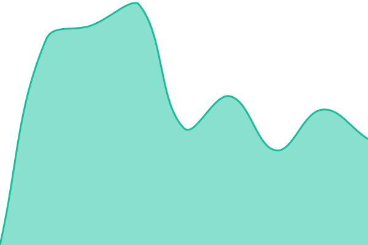
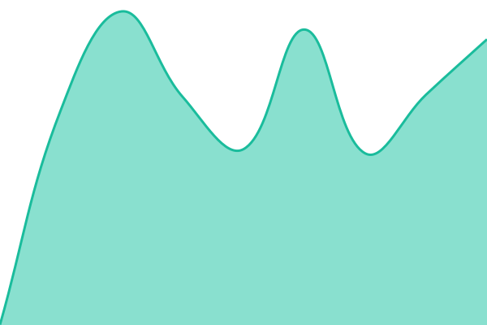

# [📈 Live Status](https://valentinrakovich-sketch.github.io/upptime): <!--live status--> **🟧 Partial outage**

This repository contains the open-source uptime monitor and status page for [valentinrakovich-sketch](https://valentinrakovich-sketch.github.io/upptime), powered by [Upptime](https://github.com/upptime/upptime).

With [Upptime](https://upptime.js.org), you can get your own unlimited and free uptime monitor and status page, powered entirely by a GitHub repository. We use [Issues](https://github.com/valentinrakovich-sketch/upptime/issues) as incident reports, [Actions](https://github.com/valentinrakovich-sketch/upptime/actions) as uptime monitors, and [Pages](https://valentinrakovich-sketch.github.io/upptime) for the status page.

<!--start: status pages-->
<!-- This summary is generated by Upptime (https://github.com/upptime/upptime) -->
<!-- Do not edit this manually, your changes will be overwritten -->
<!-- prettier-ignore -->
| URL | Status | History | Response Time | Uptime |
| --- | ------ | ------- | ------------- | ------ |
|  [specialty.ru](https://specialty.ru/robots.txt) | 🟩 Up | [specialty-ru.yml](https://github.com/valentinrakovich-sketch/upptime/commits/HEAD/history/specialty-ru.yml) | 

 1439ms
     
 | 

<a href="https://valentinrakovich-sketch.github.io/upptime/history/specialty-ru">100.00%</a>
    

|  [aremde.ru](https://aremde.ru/) | 🟥 Down | [aremde-ru.yml](https://github.com/valentinrakovich-sketch/upptime/commits/HEAD/history/aremde-ru.yml) | 

 1214ms
     
 | 

<a href="https://valentinrakovich-sketch.github.io/upptime/history/aremde-ru">100.00%</a>
    

|  [brand-rise.ru](https://brand-rise.ru/) | 🟩 Up | [brand-rise-ru.yml](https://github.com/valentinrakovich-sketch/upptime/commits/HEAD/history/brand-rise-ru.yml) | 

 1032ms
     
 | 

<a href="https://valentinrakovich-sketch.github.io/upptime/history/brand-rise-ru">100.00%</a>
    

|  [wigomat.pro](https://wigomat.pro/) | 🟩 Up | [wigomat-pro.yml](https://github.com/valentinrakovich-sketch/upptime/commits/HEAD/history/wigomat-pro.yml) | 

 718ms
     
 | 

<a href="https://valentinrakovich-sketch.github.io/upptime/history/wigomat-pro">100.00%</a>
    

<!--end: status pages-->

[**Visit our status website →**](https://valentinrakovich-sketch.github.io/upptime)

## 📄 License

- Powered by: [Upptime](https://github.com/upptime/upptime)
- Code: [MIT](./LICENSE) © [Anand Chowdhary](https://anandchowdhary.com)
- Data in the `./history` directory: [Open Database License](https://opendatacommons.org/licenses/odbl/1-0/)
